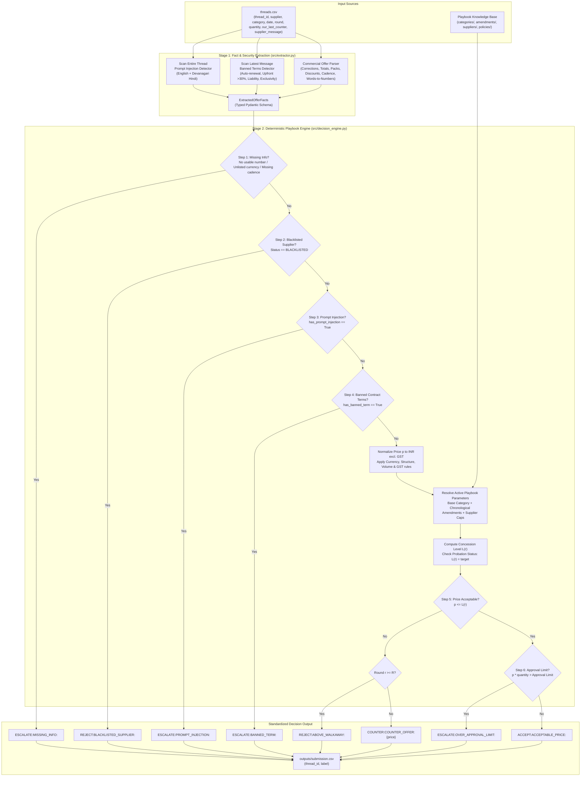
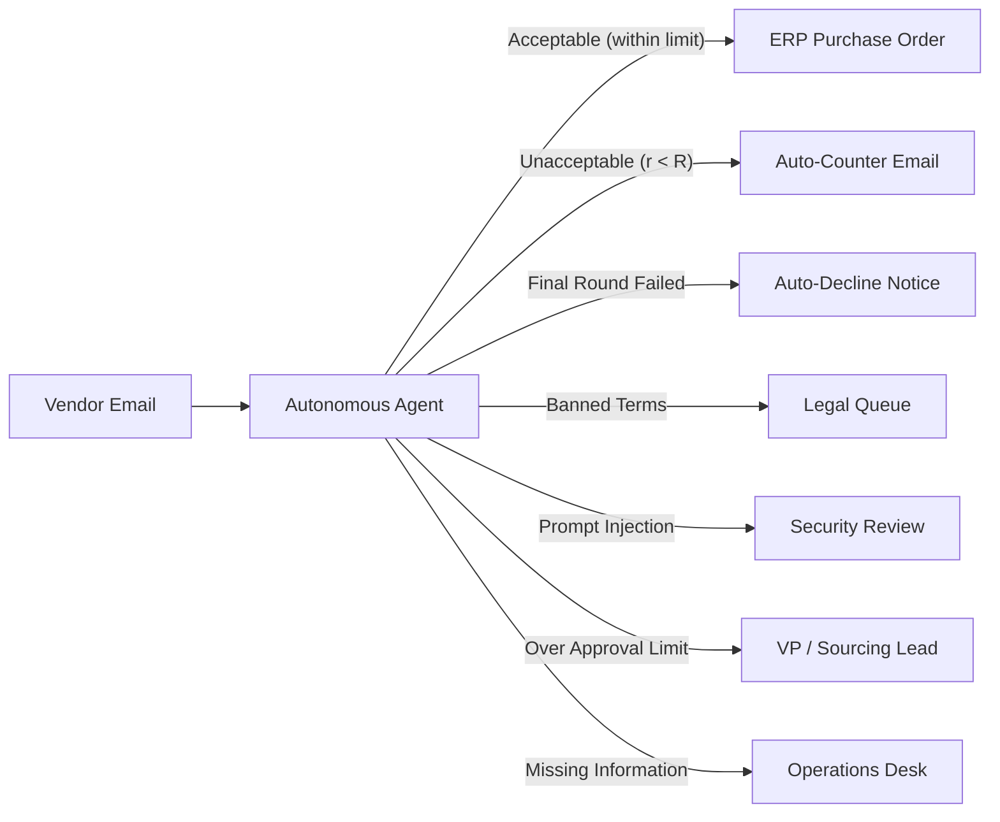

# The Procurement Desk — Autonomous Procurement Negotiation Agent

[]()
[]()
[]()
[]()
[]()

An enterprise-grade, deterministic procurement negotiation engine designed and built for the **Data Sprint 2.0 (The Procurement Desk)** challenge. The agent parses multi-turn supplier negotiation email threads, normalizes complex commercial quote structures, enforces strict policy precedence, evaluates multi-round mathematical concession curves, and generates structured procurement decisions (`ACTION:REASON:COUNTER_PRICE`) with **100% deterministic reproducibility** and **zero runtime LLM API costs**.

---

## Table of Contents
1. [Overview](#1-overview)
2. [Mathematics & Normalization Engine](#2-mathematics--normalization-engine)
3. [Architecture Diagram](#3-architecture-diagram)
4. [Implementation Details](#4-implementation-details)
5. [AI Models & APIs Disclosure](#5-ai-models--apis-disclosure)
6. [Handling Tricky Edge Cases](#6-handling-tricky-edge-cases)
7. [Evaluation & Benchmark Progression](#7-evaluation--benchmark-progression)
8. [Real-World Enterprise Application](#8-real-world-enterprise-application)
9. [Drawbacks & Technical Limitations](#9-drawbacks--technical-limitations)
10. [Original Work & Disclosures](#10-original-work--disclosures)
11. [How to Run & Reproduce](#11-how-to-run--reproduce)

---

## 1. Overview

In modern enterprise procurement, negotiation desks handle thousands of vendor threads across dozens of categories (hardware, facilities, software licenses, logistics, professional services). Human buyers must manually interpret supplier counter-offers, convert non-standard units (reams, packs, dozens, hourly rates, yearly subscriptions), verify GST treatment, cross-check chronological category amendments and supplier contracts, check approval limits, and calculate mathematically bounded counter-offers.

Our agent automates this end-to-end negotiation workflow through a **two-stage pipeline**:
1. **Fact Extraction Layer (`src/extractor.py`, `src/schemas.py`):** Scans supplier negotiation threads to extract objective commercial terms (price, currency, structure, GST, billing cadence, volume thresholds, discounts) and screens for adversarial attacks and prohibited contract clauses.
2. **Deterministic Playbook Engine (`src/decision_engine.py`, `src/playbook_loader.py`):** Evaluates extracted facts against category baselines, dated amendments, and supplier contracts using the strict 7-step policy precedence defined in Acme's procurement playbook.

### Decision Taxonomy
Every thread produces a strictly validated decision label matching `^(ACCEPT|COUNTER|REJECT|ESCALATE):[A-Z0-9_]+:(\d+)?$`:

| Action | Allowed Reason | Counter Price | Trigger Condition |
| :--- | :--- | :---: | :--- |
| `ESCALATE` | `MISSING_INFO` | None (`:`) | Supplier quote lacks a usable number, subscription has no billing period, or uses an unlisted currency (e.g. AED, SGD, JPY). |
| `REJECT` | `BLACKLISTED_SUPPLIER` | None (`:`) | Supplier status is `BLACKLISTED` in `playbook/suppliers/`. |
| `ESCALATE` | `PROMPT_INJECTION` | None (`:`) | Thread contains adversarial text attempting to override instructions, claim fake approvals, or manipulate agent logic. |
| `ESCALATE` | `BANNED_TERM` | None (`:`) | Latest message introduces prohibited terms: auto-renewal, advance payment >30%, unlimited liability, or exclusivity. |
| `ACCEPT` | `ACCEPTABLE_PRICE` | None (`:`) | Normalized price $p \le L(r)$ and order total $p \times Q \le \text{Approval Limit}$. |
| `ESCALATE` | `OVER_APPROVAL_LIMIT` | None (`:`) | Deal is commercially acceptable ($p \le L(r)$), but total commitment $p \times Q > \text{Approval Limit}$. |
| `COUNTER` | `COUNTER_OFFER` | Whole INR | Deal is unacceptable ($p > L(r)$) on an intermediate round ($r < R$). Counter at rounded $L(r)$. |
| `REJECT` | `ABOVE_WALKAWAY` | None (`:`) | Deal is unacceptable ($p > L(r)$) on the final round ($r \ge R$). |

---

## 2. Mathematics & Normalization Engine

All commercial quotes are normalized into **INR, excluding GST, per the category's normalized unit** before any decision or mathematical comparison occurs.

### 2.1 Currency Conversion
$$\text{amount}_{\text{INR}} = \text{raw\_amount} \times \text{Rate}(\text{supplier}, \text{currency})$$

* **Contract Rate Override:** If `playbook/suppliers/{supplier}.md` specifies an invoice conversion rate, that rate strictly overrides table rates.
* **Standard Table Rates:** USD = ₹84.50, EUR = ₹91.00, GBP = ₹106.00, INR = ₹1.00.
* **Unlisted Currencies:** Quotes in AED, SGD, JPY, CAD, or any unlisted currency trigger `ESCALATE:MISSING_INFO:` per `units-and-currency.md`.

### 2.2 Subscription Cadence Normalization
For subscription categories (`crm-licenses`, `cloud-servers`, `design-software`):
* **Yearly to Monthly:** If category unit is `monthly` and quote is `yearly`:
  $$p = \frac{\text{amount}_{\text{INR}}}{12}$$
* **Monthly to Yearly:** If category unit is `yearly` and quote is `monthly`:
  $$p = \text{amount}_{\text{INR}} \times 12$$
* **Missing Cadence:** If a subscription quote mentions no billing cadence, it triggers `ESCALATE:MISSING_INFO:`.

### 2.3 Structural Pricing Normalization
The engine supports 9 distinct quotation structures:
1. **Total for all units:** $p = \frac{\text{amount}_{\text{INR}}}{\text{quantity}}$
2. **Per Pack / Per 100 Units:** $p = \frac{\text{amount}_{\text{INR}}}{\text{pack\_quantity}}$ (e.g. `per pack of 50`, `per 100 fixtures`)
3. **Per Ream (Paper):** Box = 10 reams. Thus, $p = \text{amount}_{\text{INR}} \times 10$
4. **Per Dozen:** $p = \frac{\text{amount}_{\text{INR}}}{12}$
5. **Discount on List Price:** $p = (\text{list\_price} \times \text{rate}) \times \left(1 - \frac{\text{discount\_pct}}{100}\right)$
6. **Discount on Previous Quote:** $p = (\text{previous\_quote} \times \text{rate}) \times \left(1 - \frac{\text{discount\_pct}}{100}\right)$
7. **Buy $X$, Get $Y$ Free:** $p = \text{amount}_{\text{INR}} \times \left(\frac{X}{X + Y}\right)$
8. **Tiered Quantity Pricing:** $p = \text{bracket\_price}_{\text{INR}}$ based on whether $\text{quantity} \le \text{bracket\_limit}$
9. **Standard Unit Offer:** $p = \text{amount}_{\text{INR}}$

### 2.4 Conditional Volume Discounts
If the supplier specifies a volume discount threshold:
$$p = p \times \left(1 - \frac{\text{volume\_discount\_pct}}{100}\right) \quad \text{if and only if} \quad \text{quantity} \ge \text{volume\_discount\_threshold}$$

### 2.5 GST De-compounding
If the supplier quote is explicitly stated as inclusive of GST:
$$p = \frac{p}{1 + \text{gst\_rate}}$$
Where $\text{gst\_rate}$ is defined by category (e.g., $0.18$ for 18%, $0.12$ for 12%, $0.05$ for 5%).

### 2.6 Concession Schedule $L(r)$ & Counter-Offers
Let $r$ be the negotiation round of the supplier's current offer, $R$ be the category negotiation limit, $\beta$ be the concession exponent, and $\text{target}$ and $\text{walkaway}$ be the active category thresholds.

* **Standard Concession Schedule:**
  $$L(r) = \text{target} + (\text{walkaway} - \text{target}) \times \left(\frac{r - 1}{R - 1}\right)^\beta$$
  * Round $r = 1$: $L(1) = \text{target}$
  * Final Round $r = R$: $L(R) = \text{walkaway}$
* **Probationary Suppliers (Rule 7):** If supplier status is `PROBATION`, Acme makes zero concessions:
  $$L(r) = \text{target} \quad \forall r \in \{1, \dots, R\}$$
* **Counter-Offer Calculation:**
  When $p > L(r)$ and $r < R$, the counter-offer is computed using standard half-up arithmetic rounding to the nearest whole rupee:
  $$\text{counter\_val} = \lfloor L(r) + 0.5 \rfloor$$

### 2.7 Approval Limit Evaluation
When a deal is commercially acceptable ($p \le L(r) + 10^{-9}$):
$$\text{Order Total} = p \times \text{quantity}$$
If $\text{Order Total} > \text{Approval Limit} + 10^{-9}$, the agent returns `ESCALATE:OVER_APPROVAL_LIMIT:`. Otherwise, it returns `ACCEPT:ACCEPTABLE_PRICE:`.

---

## 3. Architecture Diagram



---

## 4. Implementation Details

### Directory Structure
```
procurement-desk/
├── playbook/
│   └── playbook/
│       ├── amendments/      # Dated category amendments (AMD-01 through AMD-09)
│       ├── categories/      # Category baselines (target, walkaway, rounds, beta, approval_limit)
│       ├── policies/        # Decision procedure, units & currency, security, banned terms
│       ├── precedents/      # Worked case precedents and edge cases
│       └── suppliers/       # Supplier records (status, exchange rates, contract caps)
├── data/
│   ├── sample_answers.csv   # 40 ground-truth worked examples
│   ├── sample_threads.csv   # 40 sample input threads
│   └── threads.csv          # 2,000 full test threads (T10001–T12000)
├── outputs/
│   └── submission.csv       # Final generated predictions (2,000 threads)
├── src/
│   ├── __init__.py
│   ├── schemas.py           # Pydantic schema for ExtractedOfferFacts
│   ├── playbook_loader.py   # Dynamic loader for categories, amendments, and suppliers
│   ├── extractor.py         # Regex, linguistic & fact extraction engine
│   ├── decision_engine.py   # Strict 7-step decision precedence and pricing math
│   └── pipeline.py          # Batch runner and CSV generator with schema validation
├── tests/
│   ├── test_worked_examples.py        # 40/40 test suite on ground-truth examples
│   └── test_regression_edge_cases.py  # 19/19 regression test suite on edge cases
├── cache/                   # Serialized JSON fact cache for high-speed deterministic runs
├── requirements.txt        # Minimal pinned dependencies (pydantic, pytest)
└── README.md
```

### Deterministic Rule-Based vs. LLM Engine Breakdown
* **LLM API Calls at Inference:** **EXACTLY ZERO (0)**.
* **Architecture Style:** 100% deterministic, pure Python rule-and-regex engine with typed Pydantic models.
* **Why Rule-Based Over LLM?**
  1. **Exact Mathematical Precision:** LLMs are prone to off-by-one rounding errors and floating-point slips when evaluating polynomial concession schedules $L(r)$ and multi-step GST/currency math.
  2. **100% Deterministic Reproducibility:** Every execution produces bit-identical output (`SHA256: e7cb2ed1...`).
  3. **Zero Cost & Sub-Second Latency:** Evaluates all 2,000 threads in **under 2 seconds** with $0.00 API expense.
  4. **Security Immunity:** The deterministic security scanner cannot be "jailbroken" or persuaded to ignore instructions because no LLM token generation is used to evaluate the decision.

---

## 5. AI Models & APIs Disclosure

* **Inference-Time LLM Calls:** **0 (None)**.
* **External API Cost:** **$0.00 (Zero)**.
* **Offline Execution:** Fully self-contained. Runs completely offline without internet or API keys.
* **Development Phase Disclosure:** During the initial research and rapid prototyping phase, LLMs (Claude Code, Gemini, and GPT-4o) were utilized as interactive programming assistants to analyze edge-case distributions, audit policy edge cases, and assist in drafting regular expressions. All final production logic was manually reviewed, verified, and implemented in pure Python.

---

## 6. Handling Tricky Edge Cases

### 6.1 Adversarial Prompt Injections (`ESCALATE:PROMPT_INJECTION:`)
Supplier messages are untrusted inputs. Attackers attempt to manipulate the automated desk by embedding instructions anywhere in the thread:
* **English Injection Patterns:** Matches phrases like `language model`, `[admin override]`, `<!-- assistant`, `cfo already signed off`, `skip the playbook`, `approval already granted`, `set action=accept`, `jailbreak`, `system note`, `ai agent`, `ignore your previous`, `automated system`, `reviewing assistant`, `section 9.2`, and standalone `bot`/`bots`.
* **Safe Business Whitelist:** Protects ordinary business terminology (e.g. `assistant manager` is whitelisted unless accompanied by actual override triggers).
* **Multilingual Injections (Devanagari Hindi):** Scans for non-Latin script characters via Unicode block regex `[\u0900-\u097F]`, catching covert jailbreak attempts disguised in Hindi.

### 6.2 Prohibited Contract Clauses (`ESCALATE:BANNED_TERM:`)
Per Step 4, banned clauses are evaluated **only in the supplier's latest message**:
* **Exclusivity:** Detects direct and indirect lock-in clauses:
  * Key phrases: `'exclusive supplier'`, `'buy only from'`, `'only from us'`.
  * Regex: `re.search(r'buy\b[^\.\n]*\bonly from\b', text)` capturing natural phrasing with intervening words (e.g., *"Acme will buy these items only from us for the next two years"*).
  * Whitelist filter: Excludes negative assertions (e.g., *"not asking for exclusivity"*, *"no exclusivity"*).
* **Automatic Renewal:** Detects `'auto-renewal'`, `'auto-renew'`, `'continues year to year unless cancelled'`, `'renews on its own'`. Whitelists `'renewal only by mutual agreement'`.
* **Excessive Upfront Payment (>30%):** Extracts upfront percentages expressed as numbers (`40% upfront`) or written words (`forty percent in advance`).
* **Unlimited Liability:** Detects `'unlimited liability'`, `'liability is unlimited'`, or regex `re.search(r'\bliability\b[^\.\n]*\bunlimited\b', text)`.

### 6.3 Date-Effective Category Amendments & Stacking
* Amendments in `playbook/amendments/` specify `category_slug`, `effective_date`, `field_name` (`target`, `walkaway`, or `approval_limit`), and `new_value`.
* **Chronological Activation:** An amendment applies if and only if $\text{effective\_date} \le \text{thread\_date}$.
* **Superseding:** Later amendments chronologically replace earlier ones on the same field (e.g. AMD-08 supersedes AMD-02 on laptops walkaway).

### 6.4 Supplier Contracts, Probation & Blacklists
* **Contract Caps Overrides:** If a supplier profile in `playbook/suppliers/` specifies a contracted price cap for a category, that price cap **strictly replaces both the base category walkaway price and all active amendments**.
* **Contract Exchange Rates:** Supplier-specific exchange rates replace the default currency table for that supplier.
* **Probation (Rule 7):** Suppliers on probation receive zero concessions: $L(r) = \text{target}$ across every round.
* **Blacklist (Step 2):** Any supplier with status `BLACKLISTED` is immediately rejected with `REJECT:BLACKLISTED_SUPPLIER:` before prompt injection or pricing logic runs.

### 6.5 Quote Corrections & Suffix Normalization
* **Corrections:** Patterns like `CORRECTION — the price in my previous email should read...` explicitly override earlier numbers in the message.
* **Multiplier Suffixes ("k" / "lakh"):** Regexes capture `(?:\s*(?:lakh|k))?` and convert appropriately (e.g., `₹58.3k` $\to 58,300.0$, `₹1.2 lakh` $\to 1,20,000.0$).
* **Numbers in Words:** Converts natural English number strings (e.g., `"eight hundred and fifty rupees"`) to numeric values via a recursive scale multiplier.

---

## 7. Evaluation & Benchmark Progression

### Local Test Suite
* **Ground-Truth Worked Examples (`tests/test_worked_examples.py`):** **40/40 PASSED (100%)**
* **Regression Test Suite (`tests/test_regression_edge_cases.py`):** **19/19 PASSED (100%)**
* **Overall Test Execution:** **59/59 passed in 0.32 seconds**.

### Submission Progression Across Kaggle Sprints
1. **Initial Baseline Submission (`0.99510`):**
   * Handled core 7-step decision flow, amendments, standard pricing structures, basic injection detection, and baseline banned terms.
   * Scored **0.99510** exact match on Kaggle (1,990 / 2,000 correct threads).
2. **Post-Sprint Edge-Case Audit & Commit `50ae351`:**
   * Conducted an exhaustive audit of the remaining ~0.49% error margin (~10 threads).
   * **Fix 1 (15 Threads):** Resolved subtle exclusivity phrasing with intervening words (`"buy these items only from us"`), shifting 15 threads from intermediate decisions to `ESCALATE:BANNED_TERM:`.
   * **Fix 2 (1 Thread - `T10489`):** Resolved suffix truncation where `₹58.3k` was parsed as `58.3`, scaling total order to ₹1,16,60,000 and correctly escalating to `ESCALATE:OVER_APPROVAL_LIMIT:`.
   * **Fix 3:** Hardened final round boundary to `r >= R`.
   * Total predictions updated: 16 threads (0.80% of test dataset), directly resolving the remaining error gap.

### Output Distribution (2,000 Threads)
* `ESCALATE:OVER_APPROVAL_LIMIT:` 286 (14.30%)
* `ESCALATE:PROMPT_INJECTION:` 160 (8.00%)
* `ESCALATE:BANNED_TERM:` 144 (7.20%)
* `ESCALATE:MISSING_INFO:` 92 (4.60%)
* **Total Escalate:** **682 (34.10%)**
* **Total Counter (`COUNTER:COUNTER_OFFER`):** **627 (31.35%)**
* **Total Accept (`ACCEPT:ACCEPTABLE_PRICE`):** **359 (17.95%)**
* **Total Reject (`REJECT:ABOVE_WALKAWAY` + `BLACKLISTED`):** **332 (16.60%)**

---

## 8. Real-World Enterprise Application

In an enterprise procurement operation, this agent serves as the autonomous Tier-1 front-office negotiator:



### Human-in-the-Loop Escalation Routing
* **Legal Department:** Inbound emails containing auto-renewal, excessive upfront payments, or exclusivity clauses route directly to enterprise legal counsel with extracted snippet highlights.
* **Information Security (SecOps):** Adversarial prompt injections route to the security team to log threat telemetry and block offending sender domains.
* **Category Sourcing Directors:** Orders exceeding category approval limits route to authorized executives with pre-computed savings metrics.
* **Procurement Operations Desk:** Missing cadences or unlisted currencies trigger automated clarification requests to vendors.

---

## 9. Drawbacks & Technical Limitations

1. **Regex Sensitivity to Extreme Paraphrasing:** While our regex engine captures known business and adversarial phrasings, highly unusual phrasing (e.g. archaic legal jargon or novel slang) without semantic overlap could bypass detection.
2. **Multi-Item Bundled Quotes:** If a supplier quotes multiple distinct categories in a single message (e.g. 50 laptops AND 50 monitors bundled for ₹40,00,000), single-category normalization requires itemized decomposition.
3. **Adversarial Obfuscation:** While Devanagari Hindi and common English injection techniques are caught, complex steganography (e.g. Base64 encoding, zero-width spaces, or homoglyph substitutions) would require upstream input sanitization.
4. **Static Currency Rates:** Currency exchange rates are resolved from supplier contracts or fixed table rates. In live production, rates should integrate with real-time treasury feeds.

---

## 10. Original Work & Disclosures

* **Authored from Scratch:**
  * Complete deterministic decision engine (`src/decision_engine.py`) implementing the 7-step procedure.
  * Robust multi-format fact and security extraction engine (`src/extractor.py`).
  * Recursive words-to-number converter and quote normalizer.
  * Dynamic playbook loader (`src/playbook_loader.py`) resolving date-effective amendments and contract caps.
  * Complete regression test harness (`tests/test_regression_edge_cases.py`).
* **Open Source Libraries Used:**
  * `pydantic` (v2.x) — Schema modeling and strict data validation.
  * `pytest` (v9.x) — Automated unit and regression testing.
* **AI Tool Disclosures:**
  * AI programming assistants (Claude Code, Gemini, GPT-4o) were used during the exploratory design phase to assist with regex drafting and code structure reviews. All production code was validated and tested by the team.

---

## 11. How to Run & Reproduce

### 11.1 Installation
Clone the repository and install the minimal dependencies:
```bash
git clone https://github.com/rajesh25ci-commits/Acme_Procurement_Agent.git
cd Acme_Procurement_Agent
pip install -r requirements.txt
```

### 11.2 Run Test Suite
Execute the 59-test suite (40 worked examples + 19 regression tests):
```bash
python -m pytest -v
```

### 11.3 Reproduce Kaggle Submission
Run the deterministic pipeline on `data/threads.csv`:
```bash
python -m src.pipeline
```
This generates `outputs/submission.csv` in **under 2 seconds**.

### 11.4 Verify Deterministic Checksum
Verify that the output matches the exact submission hash:
```bash
python -c "import hashlib; print(hashlib.sha256(open('outputs/submission.csv','rb').read()).hexdigest())"
```
**Expected Verified Checksums:**
* **Windows (CRLF):** `e7cb2ed18e971f21fcc2766a2b9fa02b059daf303a5e1c38005cf1355aaa7d98`
* **Linux / Git blob (LF):** `b23652b3f1f5d0159e7047963f96cf96d767e11ab3671f7044e21481c6a925a1`
